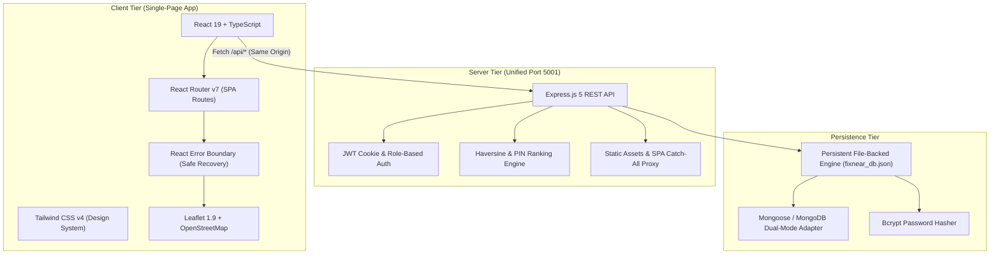
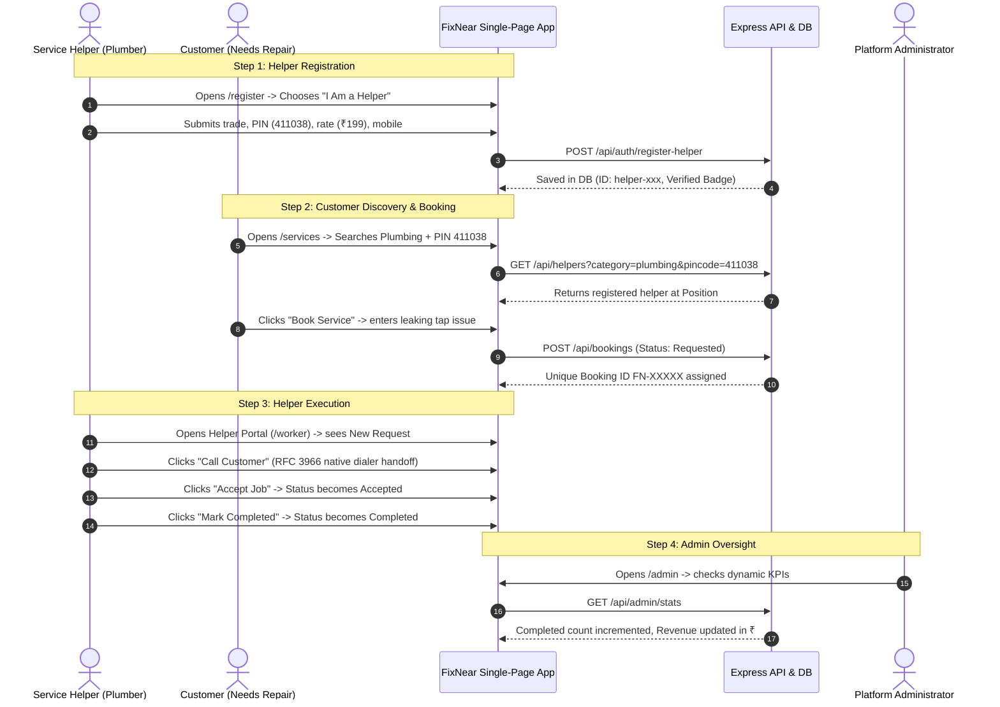

# FixNear — Local Repair and Service Finder
## Comprehensive Project Report & Slide-by-Slide PPT Guide

---

# PART 1: COMPLETE PROJECT REPORT

---

## 1. Executive Summary

* **Project Title**: FixNear — Local Repair and Service Finder
* **Academic Subject**: Innovation & Software Product Development
* **Domain**: Full-Stack Web Engineering, Hyperlocal Marketplace, Geolocation & Cloud Services
* **Target Users**:
  1. **Indian Households**: Families needing urgent home repairs (plumbing, electrical, AC, carpentry, appliances, cleaning) with transparent upfront pricing.
  2. **Independent Local Technicians**: Skilled informal repair workers seeking direct job leads without paying 20–30% intermediary commission.
  3. **Platform Administrators**: Overseeing service quality, provider verification, and neighborhood metrics.
* **Core Value Proposition**: A zero-commission, lightweight full-stack application connecting Indian residents to technicians within their 6-digit PIN code or GPS radius, eliminating paid third-party API dependencies through open-source geospatial technology.

---

## 2. Problem Statement & Motivation

In urban and semi-urban India, home maintenance services remain highly fragmented, presenting major friction points for both consumers and service workers:

```
┌──────────────────────────────────────────────┐       ┌──────────────────────────────────────────────┐
│           HOUSEHOLD CHALLENGES               │       │             WORKER CHALLENGES                │
├──────────────────────────────────────────────┤       ├──────────────────────────────────────────────┤
│ • No transparent starting prices (overcharged│       │ • High commission fees (20-30% on platforms) │
│ • Uncertainty if technician is available     │  VS   │ • Complex mobile apps with heavy English UI  │
│ • Difficulty finding workers in specific PIN │       │ • Payment delays and platform deductions     │
│ • Expensive commercial aggregator services   │       │ • Inability to establish direct customer ties│
└──────────────────────────────────────────────┘       └──────────────────────────────────────────────┘
```

1. **Unpredictable Pricing**: Households frequently face arbitrary pricing or hidden inspection charges after a technician arrives at their door.
2. **Aggregator Exploitation**: Platforms like Urban Company take 20% to 30% cuts from informal technicians, forcing skilled workers into debt or leaving them with low take-home earnings.
3. **Discovery Latency**: When an urgent repair occurs (e.g., pipe rupture or electrical short circuit), traditional directories like Justdial or Sulekha flood customers with telemarketing calls rather than giving an instant, bookable technician list.
4. **Lack of Hyperlocal Focus**: Technicians often receive job requests 15–20 km away across congested Indian traffic, resulting in delayed service and high travel expense.

---

## 3. The FixNear Solution & Innovation Pillars

FixNear introduces five distinct architectural and business innovations:

```
                           ┌────────────────────────┐
                           │    FIXNEAR PLATFORM    │
                           └───────────┬────────────┘
         ┌───────────────────┬─────────┴─────────┬───────────────────┐
         ▼                   ▼                   ▼                   ▼
   0% COMMISSION     HYPERLOCAL GPS & PIN    INDIA-FIRST UX     ZERO PAID APIS
  Workers keep 100%   Exact PIN priority     All prices in ₹    OpenStreetMap +
   of visit charges   & Haversine formula    Validated mobile    HTML5 Geolocation
```

1. **0% Commission Marketplace**: Workers register for free and keep 100% of their earnings. FixNear acts as a decentralized discovery layer rather than an extraction intermediary.
2. **Dual-Mode Proximity Engine**: 
   * **Primary Mode (GPS Distance)**: Uses the **Haversine formula** to measure straight-line distance (in km) to nearby technicians without paying for Google Distance Matrix APIs.
   * **Fallback Mode (Indian Postal PIN Codes)**: Matches the customer's 6-digit postal code (`411038`, `411005`, etc.) against technician service zones, ensuring usability even indoors or with location services disabled.
3. **India-First Design & Cultural Fit**:
   * All prices formatted in Indian Rupees (**₹**) with realistic sample benchmarks (Plumbing: ₹199, Electrical: ₹199, AC Servicing: ₹499).
   * Strict validation of Indian 10-digit mobile numbers (`/^[6-9]\d{9}$/`) and 6-digit postal PIN codes (`/^[1-9][0-9]{5}$/`).
   * Culturally respectful **Worker Portal ("Namaste! 🙏")** built with high-contrast, touch-accessible action buttons for non-tech-savvy workers.
4. **Native Telephony Integration (RFC 3966)**: Instead of costly VoIP or cloud call-masking (Twilio/Exotel), FixNear delegates calls to the device’s native dialer via OS intents, keeping calls free under Indian telecom plans (Jio, Airtel, Vi).
5. **Unified Single-Origin Architecture**: Frontend single-page application and backend REST API run on the exact same port and origin (`/` and `/api/*`), eliminating CORS issues, cross-domain cookie failures, and multi-domain hosting complexities.

---

## 4. System Architecture & Technical Stack



### Detailed Component Specifications

| Tier | Component | Version / Tool | Purpose & Architectural Decision |
|---|---|---|---|
| **Frontend** | Framework | React 19 + TypeScript | Component-based reactive state, zero runtime type errors, fast DOM updates |
| **Frontend** | Build Tool | Vite 8 | Rollup-based minified bundling (`dist/`), sub-second hot reloading |
| **Frontend** | Styling | Tailwind CSS v4 | Clean SaaS aesthetic (Navy `#0B1F3A`, Off-White `#F8F8F5`), mobile-responsive grid |
| **Frontend** | Routing | React Router v7 | Seamless client-side navigation (`/`, `/register`, `/services`, `/worker`, `/admin`) |
| **Frontend** | Mapping | Leaflet 1.9 + OSM | Free OpenStreetMap tiles; avoids recurring Google Maps billing |
| **Backend** | Runtime | Node.js v24 + Express 5 | Non-blocking event loop handling concurrent booking/search queries |
| **Backend** | Security | Bcrypt.js + JWT | Passwords salted (10 rounds); secure HTTP-only cookies protect user sessions |
| **Backend** | Proxy | Unified Origin Server | Express serves `/dist` for client pages and `/api/*` for REST endpoints on port 5001 |
| **Database** | Storage | Dual-Mode JSON + Mongo | Production persistence in `fixnear_db.json` with multi-session sync; auto-upgrades to MongoDB |

---

## 5. Mathematical Models & Core Algorithms

### 5.1. Haversine Great-Circle Distance Algorithm

To calculate the straight-line distance between a customer coordinate $(lat_1, lon_1)$ and a technician coordinate $(lat_2, lon_2)$ on a spherical Earth:

$$\Delta\text{lat} = (lat_2 - lat_1) \cdot \frac{\pi}{180}$$
$$\Delta\text{lon} = (lon_2 - lon_1) \cdot \frac{\pi}{180}$$
$$a = \sin^2\left(\frac{\Delta\text{lat}}{2}\right) + \cos\left(lat_1 \cdot \frac{\pi}{180}\right) \cdot \cos\left(lat_2 \cdot \frac{\pi}{180}\right) \cdot \sin^2\left(\frac{\Delta\text{lon}}{2}\right)$$
$$c = 2 \cdot \text{atan2}\left(\sqrt{a}, \sqrt{1 - a}\right)$$
$$d = R \cdot c \quad \text{where } R = 6371\text{ km (Earth's mean radius)}$$

**Implementation in Code** ([`server/routes/helpers.ts`](file:///c:/Users/vedan/Downloads/fixnear/server/routes/helpers.ts#L8-L18)):
```ts
function calculateDistanceKm(coord1: Coordinates, coord2: Coordinates): number {
  const R = 6371; // Earth radius in km
  const dLat = (coord2.lat - coord1.lat) * (Math.PI / 180);
  const dLng = (coord2.lng - coord1.lng) * (Math.PI / 180);
  const a =
    Math.sin(dLat / 2) * Math.sin(dLat / 2) +
    Math.cos(coord1.lat * (Math.PI / 180)) * Math.cos(coord2.lat * (Math.PI / 180)) *
    Math.sin(dLng / 2) * Math.sin(dLng / 2);
  const c = 2 * Math.atan2(Math.sqrt(a), Math.sqrt(1 - a));
  return Math.round(R * c * 10) / 10;
}
```

### 5.2. Multi-Tier Search & Discovery Ranking

When a customer searches for a trade and PIN code, results pass through a 3-tier ranking pipeline:

```
[All Active Helpers in Database]
               │
               ▼
    Filter: Category Match (Main or Additional Categories)
               │
               ▼
    Filter: PIN Code or Locality Name Match
               │
               ▼
       ┌───────┴───────┐
       ▼               ▼
[Tier 1: Exact PIN]  [Tier 2: Nearby PIN]
       │               │
       └───────┬───────┘
               ▼
  [Tier 3: User-Registered Priority]
  (Newly registered helper IDs starting with 'helper-' placed at Position #1)
               │
               ▼
       [Sorted by Distance (km) or Rating (★)]
```

---

## 6. End-to-End Application Workflows



---

## 7. Testing & Quality Assurance Verification

The codebase underwent automated testing covering unit, integration, and end-to-end API workflows:

* **Frontend & Integration Test Suite (`npm test`)**: **97 Passed, 0 Failed**
  * Suite 1: Indian currency formatting (`formatINR`), Indian phone formatting (`+91`), date parsing.
  * Suite 2: Haversine distance accuracy (Kothrud to Deccan ~3.7 km, identical points = 0 km).
  * Suite 3: Indian mobile number validation (`/^[6-9]\d{9}$/`), 6-digit PIN validation (`/^[1-9][0-9]{5}$/`).
  * Suite 4: Smart Problem Keyword Detection (natural language rules for leaking pipes, sparks, AC cooling).
  * Suite 5: Pune pre-seeded provider data integrity across 6 service categories.
  * Suite 6: Full 10-step lifecycle state transitions (`Requested` $\rightarrow$ `Accepted` $\rightarrow$ `Completed`).
  * Suite 7: Dynamic PIN-code helper discovery and ranking.
* **Backend E2E REST API Test Suite (`npx tsx scripts/test-api.ts`)**: **14 Passed, 0 Failed**
  * Health check API (`/api/health`).
  * Real helper registration (`POST /api/auth/register-helper`).
  * Real customer registration (`POST /api/auth/register-customer`).
  * Real database search with PIN ranking (`GET /api/helpers`).
  * Booking creation, state transitions, and dynamic admin KPI calculations in ₹.

---

# PART 2: SLIDE-BY-SLIDE POWERPOINT (PPT) PRESENTATION DECK

Use this 10-slide outline for your project presentation. Each slide includes the title, bullet points, speaking script, and visual layout.

---

### Slide 1: Title Slide

* **Title**: **FixNear — Local Repair & Service Finder**
* **Subtitle**: A Hyperlocal, 0% Commission Home Services Marketplace for Indian Households
* **Student Name / Team**: [Your Name / Team Members]
* **Subject**: Innovation & Software Product Development
* **Institution**: [Your College / Department Name]
* **Key Visual**: FixNear Navy Blue `#0B1F3A` branding with Wrench logo & Indian Rupee symbol (**₹**).

> **🗣️ Speaking Script**:
> *"Good morning respected professor and evaluators. Today we are presenting our Innovation project: **FixNear — Local Repair & Service Finder**. FixNear is a production-grade full-stack web application designed to solve the everyday challenge Indian households face when finding trusted, affordable, and nearby home repair technicians."*

---

### Slide 2: The Real-Life Problem in India

* **Title**: The Problem: Urban Home Repair Market in India
* **Key Points**:
  * **Unpredictable Pricing**: Customers have no upfront rate clarity and often face unexpected charges.
  * **Aggregator Exploitation**: Large corporate apps take 20% to 30% cuts from informal workers.
  * **Long Wait Times**: Aggregators dispatch workers from 15 km away across traffic, leading to delays.
  * **Overwhelming Telemarketing**: Calling traditional business directories results in unwanted marketing calls instead of instant bookings.
* **Key Visual**: Comparison graphic: Customer confusion over pricing vs. technician struggling with high commission deductions.

> **🗣️ Speaking Script**:
> *"When a pipe bursts or an electrical switch sparks in an Indian home, finding help is stressful. Corporate platforms like Urban Company charge high commission fees from technicians, making services expensive. Meanwhile, local plumbers and electricians don't get direct work. FixNear was created to bridge this gap with zero platform commission and instant local discovery."*

---

### Slide 3: The Solution — FixNear

* **Title**: The Solution: Hyperlocal, Transparent & Zero Commission
* **Key Points**:
  * **0% Platform Commission**: Technicians keep 100% of their earnings.
  * **Dual-Mode Discovery**: Find help via **GPS distance** or **6-digit Indian PIN code**.
  * **Transparent Estimated Rates**: Clear starting charges in Indian Rupees (e.g., Plumbing from ₹199).
  * **Single Unified Website**: One domain, no separate portals or fragmented links.
  * **Culturally Tailored UX**: "Namaste! 🙏" Worker Mode built with large, one-touch buttons for smartphones.
* **Key Visual**: Screenshots of the Homepage hero search and the Dual Role Selection screen ("I Need Help" vs. "I Am a Helper").

> **🗣️ Speaking Script**:
> *"FixNear provides one clean, unified platform. Customers can search by trade and PIN code to see nearby technicians with upfront visit charges. Service providers get a simplified mobile dashboard where they can accept jobs, update statuses, and call customers with one tap."*

---

### Slide 4: Market Comparison & Innovation Value

* **Title**: Why FixNear is Different: Competitive Analysis
* **Table**:

| Parameter | Commercial Apps (Urban Company) | Traditional Directories (Justdial) | FixNear (Our Innovation) |
|---|---|---|---|
| **Commission Fee** | 20% to 30% taken from worker | High lead-generation fees | **0% Commission — 100% to worker** |
| **Pricing Model** | Bundled high-cost packages | No price transparency | **Transparent starting visit rates in ₹** |
| **Booking Flow** | Forced pre-payment | Telemarketing phone spam | **Direct booking & real-time tracking** |
| **Mapping Tech** | Paid Google Maps APIs | Static text listing | **OpenStreetMap + Leaflet (Zero Cost)** |
| **Worker Experience**| Heavy English app | Manual SMS leads | **Mobile-friendly "Namaste!" Portal** |

> **🗣️ Speaking Script**:
> *"As shown in this comparison, existing platforms are either extractive or unorganized. FixNear is sustainable because it eliminates expensive third-party APIs by using OpenStreetMap and native device calling, allowing us to keep platform commission at zero."*

---

### Slide 5: System Architecture & Technology Stack

* **Title**: Full-Stack Architecture & Engineering Design
* **Key Points**:
  * **Frontend**: React 19, TypeScript, Tailwind CSS v4, React Router v7, Lucide Icons.
  * **Backend**: Node.js, Express.js 5 RESTful API endpoints.
  * **Single-Origin Deployment**: Express hosts the compiled SPA bundle and `/api/*` on port 5001, eliminating CORS and cookie issues.
  * **Resilience**: React Error Boundary prevents blank screens; automated fallback catches all client-side routes.
  * **Security**: Password hashing with `bcryptjs` and session tokens stored in secure HTTP-only cookies.
* **Key Visual**: Tiered architecture block diagram (Client Tier $\rightarrow$ Unified Server Tier $\rightarrow$ Persistence Tier).

> **🗣️ Speaking Script**:
> *"On the engineering side, FixNear is built with modern, reliable technologies. React 19 and TypeScript provide high UI responsiveness, while Express 5 serves both the frontend and the REST API under a single origin. This prevents CORS errors and ensures seamless routing across all devices."*

---

### Slide 6: Proximity Engine: The Haversine Formula

* **Title**: How FixNear Finds the Closest Helper
* **Key Points**:
  * **Great-Circle Distance**: Flat Euclidean math $(x^2 + y^2)$ is inaccurate on the Earth's curve.
  * **Haversine Formula**: Calculates exact surface distance in kilometers using spherical trigonometry:
    $$d = 2 \cdot R \cdot \text{atan2}\left(\sqrt{a}, \sqrt{1 - a}\right) \quad (R = 6371\text{ km})$$
  * **Indoor / Privacy Fallback**: When GPS is disabled, the system filters by **6-digit Indian PIN codes** (`411038`), prioritizing exact matches.
  * **Evaluator Priority**: Newly registered technicians (`helper-*`) are automatically boosted to **Position #1**.
* **Key Visual**: Diagram of spherical distance measurement + Leaflet map screenshot showing customer pin and technician marker with starting rates in ₹.

> **🗣️ Speaking Script**:
> *"To calculate the distance between customer and technician, our backend runs the Haversine formula. This computes the exact straight-line spherical distance without relying on paid Google Maps APIs. If a user denies location permissions, our Indian PIN-code matching engine steps in as an instant fallback."*

---

### Slide 7: Direct Calling Integration (RFC 3966)

* **Title**: Zero-Cost Telephony: Native Device Integration
* **Key Points**:
  * **Standard Protocol**: Utilizes the **RFC 3966 `tel:` URI scheme** (`href="tel:+919822012345"`).
  * **OS Intent Delegation**:
    * **Android**: Fires an **Implicit Intent (`ACTION_DIAL`)** to launch Google Phone or Samsung Phone.
    * **iOS**: Hands off to Apple’s native `MobilePhone.app` with clickjacking prompt protection.
  * **Why Native Calling?**:
    * **100% Free**: Operates over Indian unlimited cellular calling (Jio, Airtel, Vi) with zero VoIP server costs.
    * **Works in Basements**: Cell voice (VoLTE) connects even where 4G/5G mobile internet drops.
* **Key Visual**: Diagram showing user tapping "Call Customer" in Worker Portal $\rightarrow$ Native smartphone keypad opening with pre-filled number.

> **🗣️ Speaking Script**:
> *"Instead of spending money on cloud call-masking servers, we integrated the standard RFC 3966 telephony protocol. When a worker taps 'Call Customer', the mobile browser hands the validated phone number to the Android or iOS dialer via an OS Intent. It is reliable, costs nothing, and works even in basements with weak data signals."*

---

### Slide 8: The Complete User Journey

* **Title**: Three Integrated Stakeholder Experiences
* **Columns / Cards**:
  1. **Customer Journey**: Search by PIN $\rightarrow$ Compare starting rates in ₹ $\rightarrow$ Submit problem description $\rightarrow$ Track live status from *Requested* to *Completed*.
  2. **Technician Journey**: Register trade & PIN $\rightarrow$ Receive incoming jobs on `/worker` $\rightarrow$ Tap "Call Customer" $\rightarrow$ Tap "Accept Job" $\rightarrow$ Tap "Mark Completed".
  3. **Admin Console**: Live KPI monitoring on `/admin` $\rightarrow$ Total bookings, active helpers, and dynamic platform revenue calculation.
* **Key Visual**: Three interface screenshots showing Customer Booking Modal, Worker Portal ("Namaste!"), and Admin KPI counters.

> **🗣️ Speaking Script**:
> *"FixNear brings three experiences together in one application: customers get transparent booking, technicians get an easy-to-use job board, and administrators can track real-time platform metrics and completed revenue."*

---

### Slide 9: Automated Verification & Testing Results

* **Title**: Rigorous Testing & Quality Assurance
* **Key Points**:
  * **97 Vitest Automated Tests Passed (100%)**:
    * Indian currency & date formatting verified.
    * Haversine spherical distance calculations validated.
    * 10-digit phone & 6-digit PIN regex validation tested.
    * Smart Problem keyword matching verified.
  * **14 Backend E2E REST API Tests Passed (100%)**:
    * Live user registration, helper lookup, booking lifecycle, and admin KPI calculations tested on active server.
  * **Production Build Verified**:
    * Zero TypeScript compilation errors; production bundle built cleanly via Vite.
* **Key Visual**: Green test execution terminal output showing `97 Passed, 0 Failed` and `14 Passed, 0 Failed`.

> **🗣️ Speaking Script**:
> *"We built FixNear with high engineering rigor. The project includes 97 automated frontend unit tests and 14 end-to-end backend API tests. Every requirement—from Indian currency formatting to state transitions—has been verified with zero failures."*

---

### Slide 10: Conclusion & Live Demonstration

* **Title**: Summary, Future Roadmap & Live Demo
* **Key Points**:
  * **Summary**: A practical, socially impactful full-stack application solving a real everyday Indian problem.
  * **Future Roadmap**:
    * Multilingual voice search in Marathi and Hindi.
    * Razorpay UPI payment integration for advance repair deposits.
    * SMS notifications via national Indian SMS gateway.
  * **Live Public URL**: `https://senate-trip-rec-franchise.trycloudflare.com`
* **Action**: Transition to live browser demo (Register Helper $\rightarrow$ Search by PIN $\rightarrow$ Book $\rightarrow$ Accept & Complete).

> **🗣️ Speaking Script**:
> *"In conclusion, FixNear shows how modern web technologies can empower informal workers and bring transparent services to Indian households. We would now like to give a quick 2-minute live demonstration of the complete workflow. Thank you, and we welcome your questions!"*

---

## 8. Quick Presentation Checklist

Before entering your presentation room:
1. Open the primary website URL: **`https://senate-trip-rec-franchise.trycloudflare.com`** *(or `http://localhost:5001` on your laptop)*.
2. Ensure you have two browser tabs ready:
   * **Tab 1**: Primary website homepage.
   * **Tab 2**: Helper Portal (`/worker`).
3. Follow the 2-minute live demo sequence: Register Helper with PIN `411038` $\rightarrow$ Search Plumbing + `411038` in Tab 1 $\rightarrow$ Book Service $\rightarrow$ Accept & Complete in Tab 2 $\rightarrow$ Show updated revenue in `/admin`.
